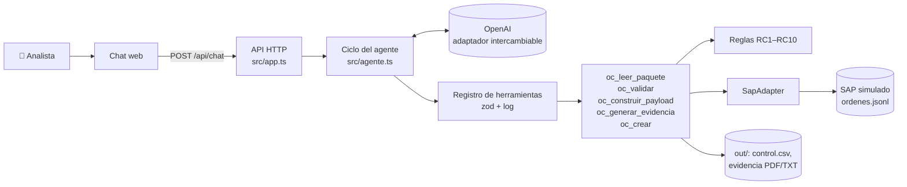

# 🧾 Agente de Órdenes de Compra SAP — Reto Técnico 03

[](https://github.com/jogarzonpa-lang/agente-ordenes-compra-sap/actions/workflows/ci.yml)


Agente conversacional que automatiza la **lectura, validación de controles y creación de órdenes de compra (OC)** en un SAP simulado, a partir del correo de una solicitud de compra (solicitud + cotización + aprobación del líder).

---

## 🔗 Enlaces

| | |
|---|---|
| 🤖 **Demo en vivo (chat)** | [Hugging Face Space](https://jogarzonpa-reto-03.hf.space) |
| 📄 **Informe técnico (página)** | [GitHub Pages](https://jogarzonpa-lang.github.io/agente-ordenes-compra-sap/) |
| 📘 **Documentación técnica** | [`SOLUCION.md`](SOLUCION.md) |
| 📓 **Verificación en Kaggle** | [`notebooks/kaggle-verificacion.ipynb`](notebooks/kaggle-verificacion.ipynb) |

---

## 🧠 Resumen de la solución

La analista de Compras digita hoy cada OC a mano y valida los controles de memoria. El agente separa **lo que debe ser determinista** (reglas, montos, creación en SAP) de **lo que sí hace bien un modelo** (orquestar, explicar, conversar):

| Capa | Responsabilidad | Dónde |
|---|---|---|
| Comportamiento | Rol, reglas y formato de respuesta del agente | [`agent/prompt.md`](agent/prompt.md) |
| Conocimiento | Proceso de OC, controles, glosario | [`src/knowledge/`](src/knowledge/ordenes-compra.md) |
| Ejecución | 5 herramientas tipadas con **zod** | [`src/tools/oc.ts`](src/tools/oc.ts) |
| Reglas | Controles RC1–RC10 (puros, sin E/S) | [`src/rules.ts`](src/rules.ts) |
| Ciclo del agente | Modelo ⇄ herramientas, topes, confirmación humana | [`src/agente.ts`](src/agente.ts) |
| SAP | Interfaz `SapAdapter` + simulación sobre archivos | [`src/sap/`](src/sap) |

### 🛡️ Garantías de diseño

- **El modelo no inventa valores:** las herramientas releen el caso desde las fixtures e ignoran lo que el modelo reenvíe; `oc_crear` compara el payload contra el recalculado.
- **La confirmación humana se fuerza en el backend, no en el prompt:** solo se crea una OC con excepciones si el agente preguntó antes y el usuario confirmó en su mensaje siguiente.
- **Idempotencia:** procesar dos veces la misma solicitud devuelve la misma OC.
- **Topes de costo:** iteraciones por turno, tokens por sesión y tokens globales.
- **Trazabilidad:** cada campo del payload declara su fuente; cada llamada queda en `out/log.jsonl`.

---

## 🏗️ Arquitectura



---

## ✅ Resultados de los 6 casos (demo sin modelo)

| Caso | Situación | Resultado |
|---|---|---|
| `sol-001` | Solicitud limpia | ✅ OC `4500000001` creada sin intervención |
| `sol-002` | Proveedor inexistente | ⛔ Bloqueada (RC1) |
| `sol-003` | Aprobador no autorizado en el centro de costo | ⛔ Bloqueada (RC2) |
| `sol-004` | Cotización 6 % distinta de la solicitud | ⚠️ Pide confirmación (RC5) → ✅ `4500000002` |
| `sol-005` | Factura anterior a la solicitud | ⚠️ Retroactiva (RC8) → ✅ `4500000003`, marcada |
| `sol-006` | Indicador de IVA no informado | ⚠️ Propone C1 (RC6) → ✅ `4500000004` |
| `sol-001` otra vez | Reintento | ♻️ Misma OC, `idempotente: true` |

Las 13 pruebas automáticas cubren, sin red ni clave de modelo: el ciclo del agente, la confirmación humana (el modelo no puede confirmar por su cuenta), los topes, la API, la descarga de evidencia y el adaptador de OpenAI.

---

## 📁 Estructura del repositorio

```
agente-ordenes-compra-sap/
├── agent/prompt.md              # system prompt (comportamiento)
├── src/
│   ├── knowledge/               # conocimiento del proceso
│   ├── tools/oc.ts              # herramientas tipadas con zod
│   ├── tools/registry.ts        # validación de args + log de llamadas
│   ├── rules.ts                 # controles RC1–RC10
│   ├── paquete.ts · orden.ts    # lectura, payload, evidencia, trazabilidad
│   ├── agente.ts                # ciclo del agente y confirmación humana
│   ├── app.ts · server.ts       # API HTTP
│   ├── llm/                     # interfaz del proveedor + OpenAI
│   └── sap/                     # SapAdapter + mock
├── web/index.html               # chat con llamadas a herramientas visibles
├── demo.ts                      # verificación de los 6 casos, sin modelo
├── test/agente.test.ts          # 13 pruebas sin red
├── fixtures/reto-03/            # maestros y 6 casos de prueba
├── modulo/                      # bonus: agente empaquetado (generado de las mismas fuentes)
├── notebooks/                   # verificación reproducible en Kaggle
├── docs/                        # página de GitHub Pages (informe)
├── deploy/                      # README del Space de Hugging Face
├── Dockerfile · .env.example
└── SOLUCION.md                  # documentación técnica
```

---

## 🚀 Ejecutar localmente

```bash
git clone https://github.com/jogarzonpa-lang/agente-ordenes-compra-sap.git
cd agente-ordenes-compra-sap
bun install

bun run demo.ts        # 6 casos sin modelo (no necesita ninguna clave)
bun run test           # 13 pruebas sin red

export OPENAI_API_KEY=sk-...
bun run dev            # chat en http://localhost:7860
```

Con Node 20+: `npm install && npm run dev:node`. Variables en [`.env.example`](.env.example).

## 💬 ¿Cómo interactuar con el agente?

- `Procesa la solicitud "sol-001".`
- `Procesa la solicitud "sol-004". Muéstrame la OC como quedaría en SAP, qué validaciones pasó y cuáles no, y no la crees hasta que yo lo confirme.` → luego pulsa **Confirmo**.
- `Procesa la solicitud "sol-005".` → el agente señala que es una OC retroactiva.
- `Procesa la solicitud "sol-002".` → bloqueada, con el motivo y la acción sugerida.

Tras crear una OC, el chat ofrece la **evidencia de aprobación en PDF/TXT** y el payload en JSON.

---

## 📓 Verificación en Kaggle

[`notebooks/kaggle-verificacion.ipynb`](notebooks/kaggle-verificacion.ipynb) clona este repositorio y ejecuta **el mismo backend** (pruebas, demo y, opcionalmente, el agente contra OpenAI) en Kaggle. Es una forma reproducible de verificarlo, no una implementación aparte.

---

## 🔌 SAP real (diseño)

El diseño del adaptador de producción (OData `API_PURCHASEORDER_PROCESS_SRV` o `BAPI_PO_CREATE1`, mapeo de campos, autenticación, idempotencia y manejo de errores parciales) está en la [sección 6 de `SOLUCION.md`](SOLUCION.md).

## 🔍 Hallazgo de proceso: OC retroactivas

En `sol-005` la OC se solicita **después** de recibir la factura. El agente las marca y las registra en `control.csv` para poder medirlas; el análisis y la propuesta de cambio están en la [sección 7 de `SOLUCION.md`](SOLUCION.md).

---

## 👤 Autor

**Jose Sebastian Garzon Parra** · [GitHub](https://github.com/jogarzonpa-lang)

> *Prueba técnica — Periferia IT Group · Octubre 2026*
